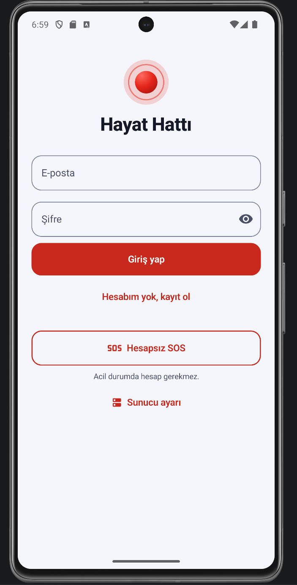
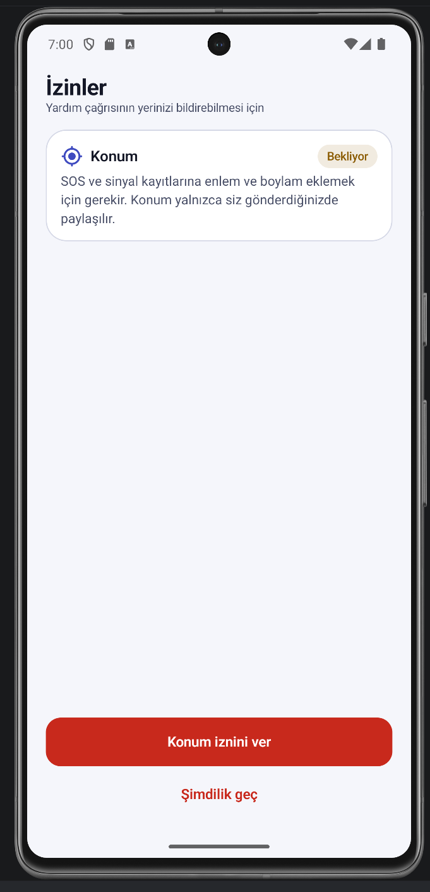
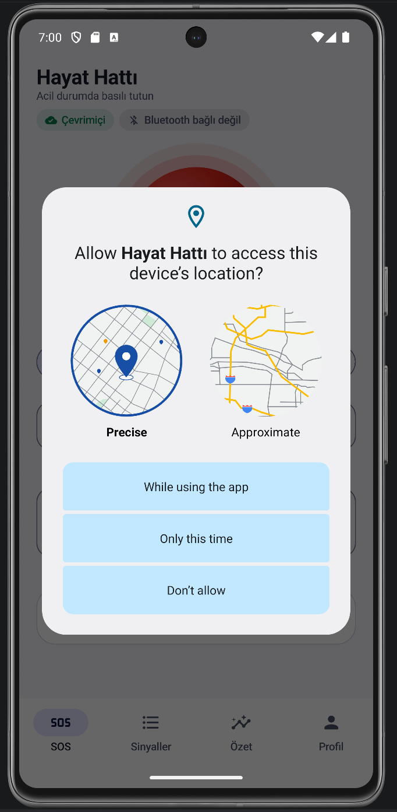
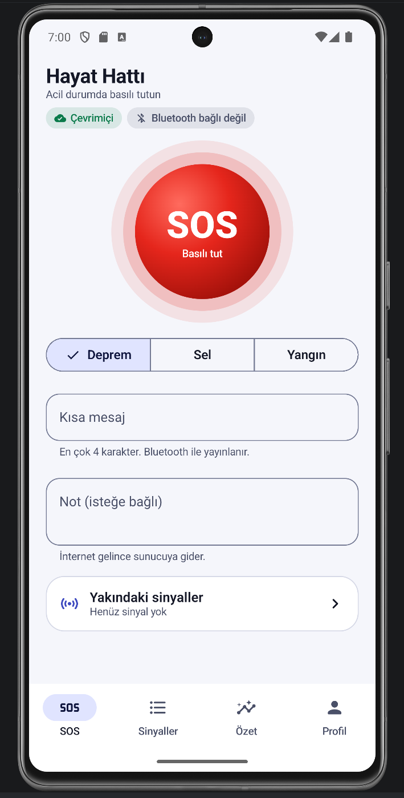
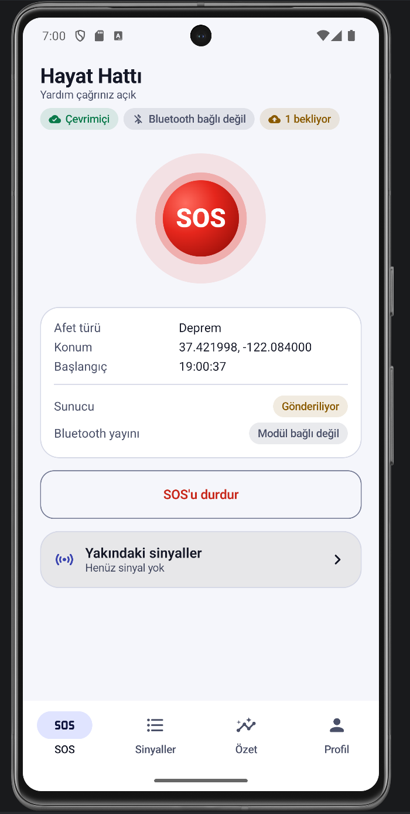
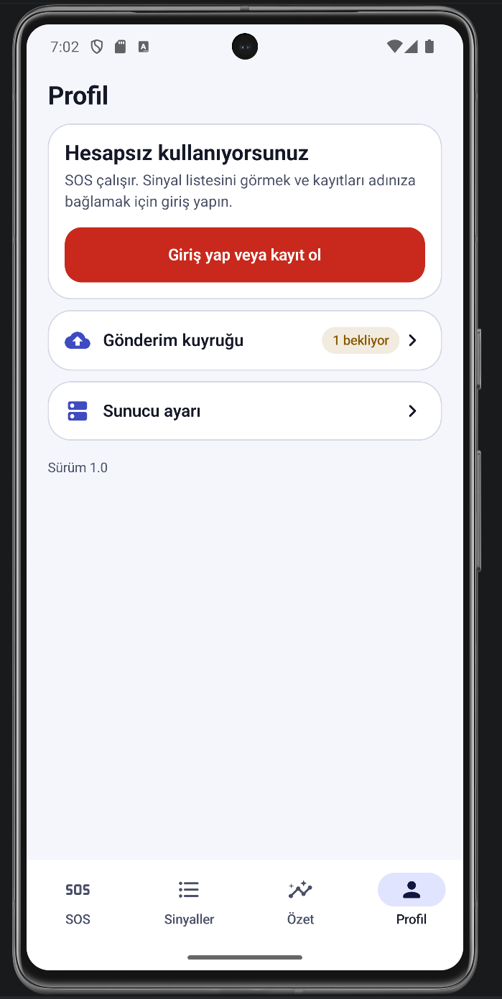

# 🚨 Hayat Hattı – Acil Durum Destek Sistemi

**Hayat Hattı**, afet ve acil durum senaryolarında bireylerin konum ve yardım taleplerini hızlı şekilde iletebilmesini amaçlayan **mobil + backend** tabanlı bir destek sistemidir.  
Proje; **Bluetooth Low Energy (BLE)**, mobil uygulama ve **REST API** mimarisini birlikte kullanır.

## 🎯 Amaç

- Afet anında **internet olmasa bile** BLE üzerinden sinyal toplanması
- Mobil uygulama aracılığıyla verilerin **backend’e iletilmesi**
- Konum, mesaj ve zaman bilgisiyle **acil yardım taleplerinin kayıt altına alınması**
- Yetkililer için **takip edilebilir bir altyapı** oluşturulması

## 🧱 Genel Mimari

BLE Cihaz / Beacon → Kotlin Mobil Uygulama → FastAPI Backend → PostgreSQL / MongoDB

> Not: Backend, BLE ile doğrudan konuşmaz. Akış: **BLE → Mobil → Backend**

## 🛠️ Teknolojiler

### Backend
- Python (FastAPI)
- Pydantic
- SQLAlchemy
- PostgreSQL (Neon / Railway)
- MongoDB (opsiyonel)
- Railway (deploy)

### Mobil
- Kotlin, Jetpack Compose, Material 3
- Retrofit + kotlinx.serialization (REST API entegrasyonu)
- Room (çevrimdışı gönderim kuyruğu), WorkManager (otomatik yeniden gönderim)
- DataStore + Android Keystore (oturum bilgisinin şifreli saklanması)
- BLE (Bluetooth Low Energy)

### Diğer
- Swagger / OpenAPI
- Git & GitHub

## ✅ Temel Özellikler

- BLE üzerinden acil sinyal algılama
- Konum bilgisi gönderimi (latitude / longitude)
- Acil mesaj ve durum kaydı
- Zaman damgalı kayıt (timestamp)
- Swagger arayüzü ile API test edilebilirliği
- Modüler ve genişletilebilir yapı

## 📱 Mobil Uygulama (Kotlin Frontend)

> Kotlin mobil uygulamasının arayüzü ve backend bağlantısı **Neslihan LOKMAN** tarafından geliştirilmiştir.

Uygulama `mobile/` klasöründedir.
### Ekranlar

| Giriş | İzinler | Konum izni |
|:---:|:---:|:---:|
|  |  |  |

| SOS | SOS açık | Profil |
|:---:|:---:|:---:|
|  |  |  |

  
### Ekip Çalışması Görev Dağılımı:
- Backend → ELİF SAKAR
- Veri Tabanı → FİRDEVS KÖSE
- Frontend (Kotlin mobil uygulama) → NESLİHAN LOKMAN
- BLE → BEYDA KIZILDAĞ
- Test → ŞEVAL PÖZE
