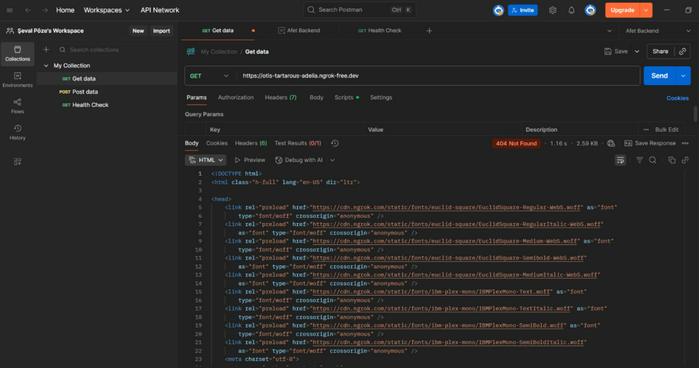
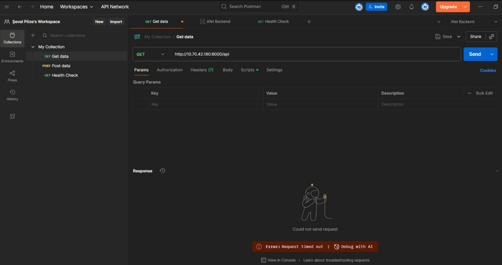
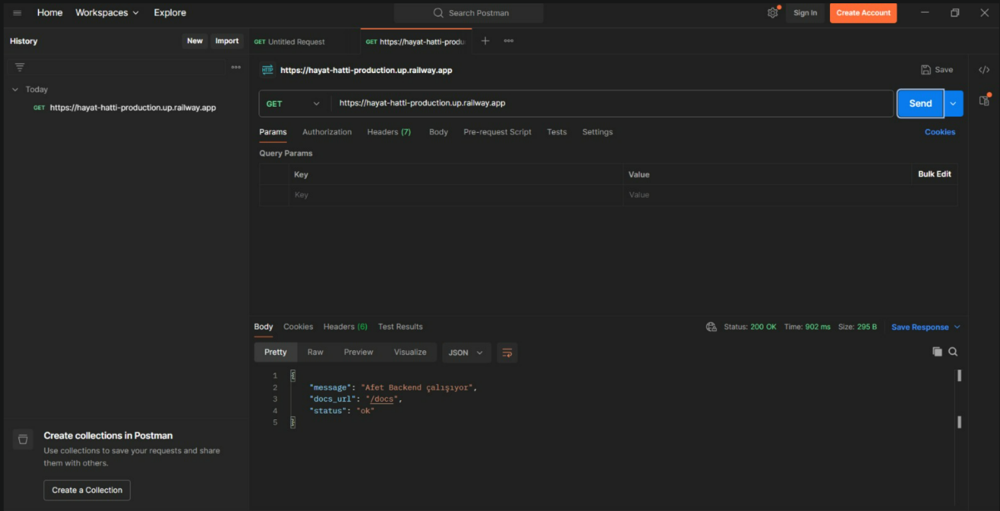
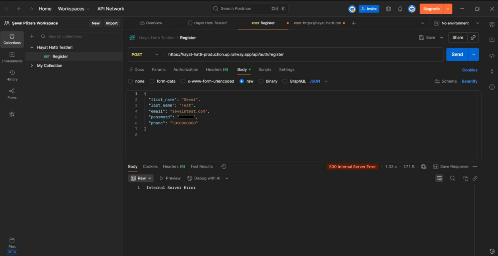
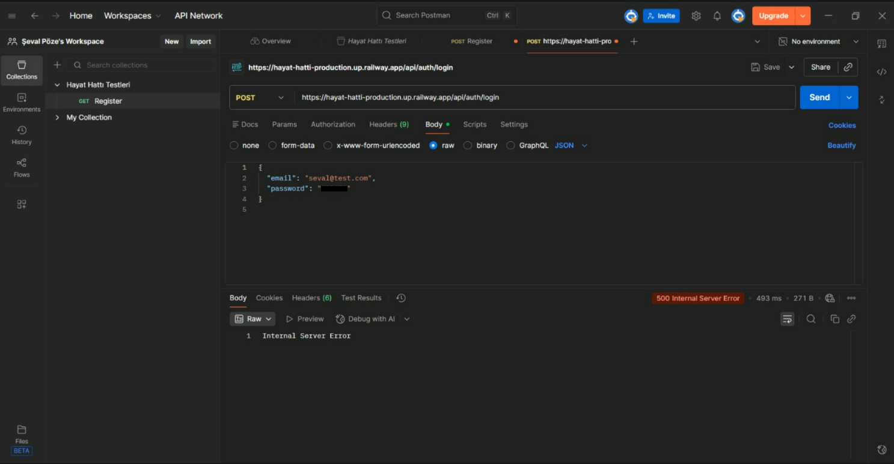

 # Hayat Hattı – Postman API Test Raporu

## 1. Test Bilgileri

- **Proje Adı:** Hayat Hattı – Afet Sonrası Çevrimiçi Yardım Ağı
- **Test Sorumlusu:** Şeval Pöze
- **Test Aracı:** Postman
- **Test Türü:** API Fonksiyonel Testleri
- **Test Edilen Sistem:** FastAPI tabanlı backend
- **Test Tarihi:** 11.03.2026

## 2. Testlerin Amacı

Bu çalışmada, Hayat Hattı projesinin backend servislerinin erişilebilirliği ve kullanıcı kimlik doğrulama işlemleri Postman aracılığıyla test edilmiştir.

Testler kapsamında HTTP istekleri gönderilmiş, sunucudan alınan yanıtlar ve HTTP durum kodları incelenmiştir. Başarılı yanıtlar, bağlantı sorunları ve sunucu hataları ekran görüntüleriyle belgelenmiştir.

## 3. Postman API Test Sonuçları

| Test No | Test Edilen İşlem | HTTP Durum Kodu | Gözlemlenen Sonuç |
|---|---|---|---|
| 1 | Ngrok üzerinden API bağlantısı | 404 Not Found | İstenen kaynak bulunamadı. |
| 2 | Yerel API bağlantısı | Timeout | Sunucudan belirlenen sürede yanıt alınamadı. |
| 3 | Railway üzerinden backend bağlantısı | 200 OK | Sunucudan başarılı yanıt alındı. |
| 4 | Kullanıcı kaydı (Register) | 500 Internal Server Error | Kayıt isteği sırasında sunucu hatası oluştu. |
| 5 | Kullanıcı girişi (Login) | 500 Internal Server Error | Giriş isteği sırasında sunucu hatası oluştu. |

### Genel Değerlendirme

Toplam 5 API isteği Postman aracılığıyla incelenmiştir. Railway üzerinden gerçekleştirilen bağlantı isteğinde başarılı yanıt alınırken diğer isteklerde HTTP hata kodları veya zaman aşımı gözlemlenmiştir.

Bu sonuçlar, API erişilebilirliği ve kullanıcı kimlik doğrulama işlemlerinin daha ayrıntılı incelenmesi gerektiğini göstermektedir. Hataların kesin nedenlerinin belirlenmesi için backend loglarının kontrol edilmesi önerilmektedir.

HTTP hata kodlarının görülmesi tek başına testin başarısız olduğunu göstermez. Test sonuçlarının, her API isteği için beklenen davranışlarla karşılaştırılması gerekmektedir.

## 4. Test Ekran Görüntüleri

Gerçekleştirilen API testlerine ait Postman ekran görüntüleri aşağıda sunulmuştur.

### Test 1 – Ngrok API Bağlantısı (404)

### Test 2 – Yerel API Bağlantısı (Timeout)

### Test 3 – Railway Backend Bağlantısı (200 OK)

### Test 4 – Kullanıcı Kaydı (500)

### Test 5 – Kullanıcı Girişi (500)

## 5. Sonuç ve Öneriler

Postman aracılığıyla gerçekleştirilen API testleri sonucunda backend servislerinin erişilebilirliği ve kullanıcı işlemlerine ilişkin çeşitli durumlar gözlemlenmiştir.

Testlerde elde edilen bulgular doğrultusunda:

- Ngrok bağlantısındaki 404 yanıtının endpoint ve yönlendirme yapılandırması açısından incelenmesi,
- Yerel API bağlantısındaki zaman aşımı sorununun araştırılması,
- Kullanıcı kayıt ve giriş işlemlerindeki 500 sunucu hatalarının backend logları üzerinden analiz edilmesi,
- Gerekli düzeltmelerden sonra ilgili API testlerinin tekrar gerçekleştirilmesi önerilmektedir.

Bu çalışma kapsamında gerçekleştirilen testlerin sonuçları ve ekran görüntüleri, proje ekibinin mevcut sorunları değerlendirebilmesi ve sistemin geliştirilmesine katkı sağlamak amacıyla belgelenmiştir.
